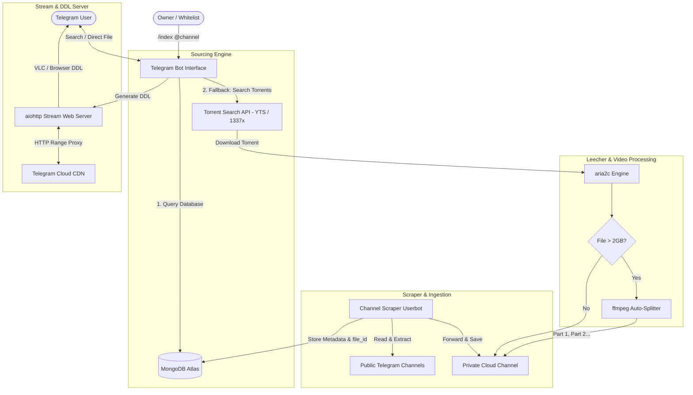
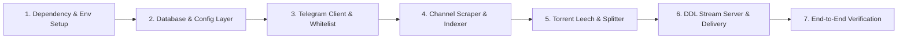

# Implementation Plan: Hybrid Telegram Movie Bot

We have resolved all design decisions through our interview. This document outlines the confirmed architecture and sequential implementation plan.

---

## Confirmed Specifications

| Requirement | Selected Decision |
| :--- | :--- |
| **Sourcing Strategy** | **Hybrid Model**: Indexes public Telegram channels first; falls back to cloud torrent leeching. |
| **File Sizing** | Shows all qualities (including 4K); automatically splits files > 2GB into numbered parts using `ffmpeg`. |
| **Delivery Mode** | Inline search list; delivers native Telegram video file with **Direct Download Link (DDL)** in the caption. |
| **Channel Scraping** | Pre-configured startup channel list + on-demand `/index @channel` command. |
| **Access Control** | **Private / Whitelist**: Restricted to your Telegram User ID (and approved friend IDs). |
| **Runtime Environment** | Local PC (Windows) first with automated dependency checking (`aria2c`, `ffmpeg`); portable to Oracle Cloud Always-Free / VPS. |

---

## System Architecture

---

## Step-by-Step Implementation Roadmap

1. **Step 1: Environment & Dependency Setup**
   - Create PowerShell script `scripts/check_dependencies.ps1` to verify/install `ffmpeg`, `aria2c`, and Python libraries.
   - Set up `requirements.txt` (`hydrogram`, `tgcrypto`, `motor`, `aiohttp`, `aria2p`, `beautifulsoup4`, `requests`).
   - Create `.env.example` with clear parameter descriptions.

2. **Step 2: Database & Config Layer**
   - Implement `config.py` with validation for Telegram keys, channels, and whitelist user IDs.
   - Implement `bot/utils/database.py` with asynchronous MongoDB operations (`motor`) for saving, searching (regex matching), and deduplicating media.

3. **Step 3: Core Telegram Client & Security Filter**
   - Implement dual-client manager (`client.py`):
     - `BotClient` (Bot Token) for interaction and delivery.
     - `UserClient` (API ID/Hash) for scraping channels where bot cannot be added.
   - Implement whitelist middleware (`handlers/start.py`) ensuring unauthorized users are rejected.

4. **Step 4: Channel Scraper & Indexer (`handlers/indexer.py`)**
   - Implement historical message crawler for public channels via `/index @channel`.
   - Implement live message listener for ongoing indexing.
   - Automatically forward files to your private storage channel and record the `file_id`.

5. **Step 5: Torrent Leech & Video Splitter (`bot/utils/torrent.py`, `splitter.py`)**
   - Build torrent search engine querying high-seed releases.
   - Implement download manager with progress tracking via `aria2c`.
   - Implement `ffmpeg` lossless stream splitter for any file exceeding 1.99 GB.

6. **Step 6: DDL Stream Server & Delivery Handler (`bot/utils/streamer.py`, `handlers/search.py`)**
   - Set up asynchronous `aiohttp` web server handling HTTP Range requests for direct VLC/browser streaming.
   - Build the interactive search interface returning inline buttons and the final message with the video file and DDL in the caption.

7. **Step 7: Verification & Testing**
   - Test scraping a public channel.
   - Test search query resolution and file delivery.
   - Test torrent fallback with a sample public-domain movie.
