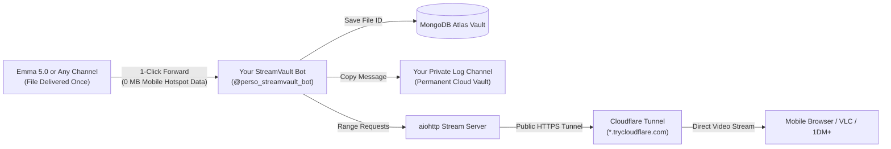

# Telegram Movie Channel & Bot Ecosystem: Architecture & Deep Dive

This document analyzes the mechanics of the Telegram movie piracy ecosystem, explaining why public movie channels only share links, how bots like **Emma 5.0** operate behind the scenes, and how **StreamVault** provides a private, ad-free, zero-data alternative.

---

## 1. Why Public Channels Don't Post Movie Files Directly

When browsing popular movie channels on Telegram (such as `M2LINKS` with 306K subscribers or `All Movies || @CineHu...` with 44K subscribers), users notice that **no direct `.mkv` or `.mp4` video files are uploaded directly in the channel**. Instead, channels post promotional posters, reaction emojis, VPN affiliate ads, and external links like:

```text
Sigma (2026) WEBDL | Hindi Tamil
720p: http://playmast.com/watch/6up5sd9
1080p: http://playmast.com/watch/4cai0np
How to watch or Download: https://t.me/openplaymast/2
```

### The Two Critical Reasons:

### A. Automated DMCA & Copyright Bans
* Telegram aggressively removes channels reported for copyright violations by major production houses (e.g., Disney, Sony, Star India, Netflix).
* If a channel with hundreds of thousands of members hosts multi-gigabyte copyrighted files directly, automated Telegram bots or rights holders submit copyright strikes.
* Channels that host raw pirated files get banned within hours or days.
* **The Channel Owners' Solution:** Keep the public channel strictly as an **ad storefront / directory**. No copyrighted media resides in the public channel itself.

### B. Monetization via Aggressive Ad Networks (Shorteners)
* Links like `playmast.com`, `droplink.co`, or `shareus.io` are **URL Shorteners / Ad-Walls**.
* Channel owners earn between **\$2.00 to \$6.00 per 1,000 clicks**.
* When a user clicks those links, they are forced through 3 to 5 redirect pages filled with:
  - Pop-up ads and adult/gambling site banners.
  - 15-second countdown timers.
  - Deceptive "Click to Download" fake buttons.
  - Captchas designed to maximize page impressions.
* Only after the user navigates through the ad gauntlet does the site redirect them to the actual media or a Telegram deep-link.

---

## 2. How Telegram Movie Bots (Like Emma 5.0) Actually Work

Bots such as **Emma 5.0** (with 75,000+ monthly active users) act as the file delivery nodes. Their internal architecture mirrors a commercialized version of StreamVault:

```mermaid
flowchart TD
    subgraph Telegram Infrastructure
        A["Private Storage / Log Channel<br/>(Hidden from Public)"] -->|"Cloud-to-Cloud Copy"| B["Bot: Emma 5.0"]
    end
    
    subgraph User Experience (The Ad Paywall)
        U["User Searches 'Karate Kid'"] --> B
        B --> C{"Check 1: Joined Sponsor Channels?<br/>(Force-Sub / FSUB)"}
        C -- "No" --> D["Block File Delivery<br/>'Please join Main Channel to use bot'"]
        C -- "Yes" --> E{"Check 2: Has Valid 15-Hour Token?"}
        E -- "No" --> F["Redirect to URL Shortener<br/>'YOU ARE NOT VERIFIED! Click to verify'"]
        F --> G["User Solves Captchas & Views Ads"]
        G --> H["Grant 15-Hour Token in Database"]
        H --> E
        E -- "Yes" --> I["Deliver Movie File (.mkv) to User Chat!"]
    end
```

### Key Components of Bot Architecture:

1. **The Secret Database Channel (Log Channel):**
   * The bot administrators create a private Telegram channel where only the admin and the bot are members.
   * Movies (e.g., `Karate Kid Legends 2025 HQ HDRip - 3.27 GB`) are uploaded to this private channel once.
   * The bot records the `file_id`, file size, and movie name in a MongoDB database.

2. **Force-Subscription (FSUB):**
   * When a user clicks `/start` or searches for a title, the bot calls `client.get_chat_member(channel_id, user_id)`.
   * If the user is not a member of the sponsor channels (`Main Channel`, `All Movies Links`), the bot refuses to return results.
   * This is how bot operators sell advertising packages to channel owners wishing to gain thousands of subscribers.

3. **15-Hour Token Verification Gate:**
   * To prevent users from downloading freely, the bot generates a temporary token:
     `/start token_xyz123`
   * This token links to a URL shortener that expires after 15 hours.
   * Every 15 hours, the user must re-visit the shorteners and view ads to refresh their access.

4. **Cloud-to-Cloud File Dispatch:**
   * When verification passes, the bot executes:
     ```python
     await client.copy_message(
         chat_id=user_id,
         from_chat_id=PRIVATE_LOG_CHANNEL,
         message_id=target_message_id
     )
     ```
   * The file is transferred **cloud-to-cloud** from the hidden storage channel to the user's private message box. The bot owner incurs **0 MB** of server bandwidth because Telegram servers handle the transfer internally.

---

## 3. How StreamVault Solves the Entire Problem

StreamVault gives you your own personal, self-hosted streaming engine and vault, eliminating every restriction, shortener, and expiration.



### Why StreamVault is Superior:

1. **Zero Mobile Data Consumption:**
   * When you forward a movie (like the 3.27 GB Karate Kid file) from Emma 5.0 to `@perso_streamvault_bot`, the transfer is completely cloud-to-cloud inside Telegram.
   * **Your mobile hotspot data used: 0 MB.**

2. **Permanent Ownership (No 15-Hour Expirations):**
   * StreamVault copies the media into your own private Telegram Log Channel and records it in your MongoDB Atlas cluster.
   * You never have to re-verify, click shorteners, or join sponsor channels again.

3. **Direct HTTP Streaming for VLC & Mobile Browsers:**
   * StreamVault's built-in `aiohttp` server exposes a direct streaming link:
     `https://<your-subdomain>.trycloudflare.com/stream/<unique_id>`
   * When opened in VLC or mobile Chrome, StreamVault maps HTTP Range Requests into Telegram MTProto media chunks on the fly.
   * The video streams instantly without needing to download the entire 3GB file to your PC first.

---

## 4. Technical Optimizations & Performance Breakthroughs

During testing on Windows 11 with Python 3.14 on an Airtel 5G connection, two major technical hurdles were identified and resolved:

### A. MTProto Decryption Speedup (`pyaes` vs `cryptg`)
* **The Problem:** In Python 3.14 on Windows, `tgcrypto` is unavailable. Hydrogram defaulted to `pyaes` (pure Python).
* Pure Python AES decryption required **15 to 20 seconds per 1 MiB chunk** (65,536 iterations of pure Python loops), triggering Telegram's 15-second socket timeout:
  `Retrying "upload.GetFile" due to: Request timed out`
* **The Solution (`bot/utils/crypto_patch.py`):**
  We implemented an automatic monkey-patch that injects `cryptg.decrypt_ige` and `cryptg.encrypt_ige` (C/Rust-compiled AES-NI hardware instructions) into `hydrogram.crypto.aes`.
* **Benchmark Result:**
  - `pyaes`: ~15,000 ms per 1 MiB
  - `cryptg`: **1.78 ms per 1 MiB (>8,000x faster!)**
  - Streaming starts instantly, and timeouts are permanently eliminated.

### B. Accurate 1 MiB Chunk Offset Slicing
* Telegram's MTProto API method `upload.GetFile` accepts offsets in **1 MiB chunk counts**, not byte offsets.
* `streamer.py` translates arbitrary byte ranges (e.g., `bytes=52428800-104857600` for video seeking) into exact 1 MiB chunk indexes (`offset_chunk = start_byte // 1048576`) and byte slices, allowing flawless VLC seeking.

### C. Dynamic 5G Hotspot IP & MongoDB Atlas
* Mobile 5G networks (Airtel) use dynamic CGNAT IP addresses that change across connections.
* To prevent `SSL: TLSV1_ALERT_INTERNAL_ERROR`, MongoDB Atlas Network Access is configured to allow `0.0.0.0/0` (secured with username/password credentials and `certifi` CA validation).
