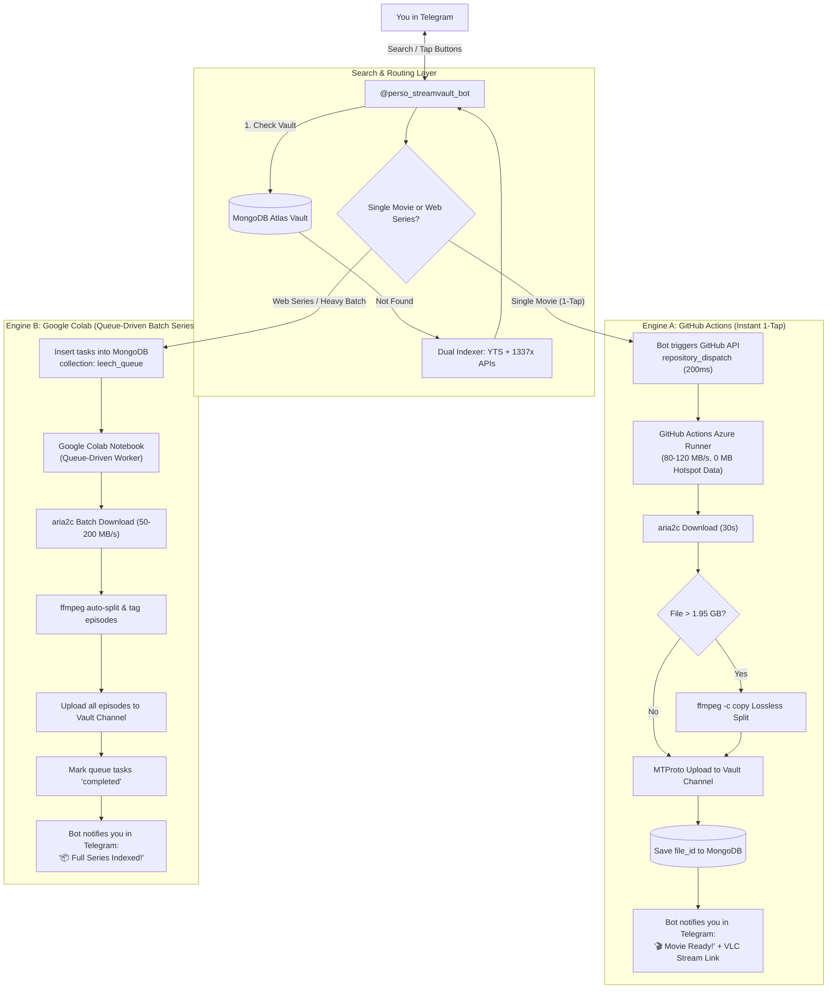

# Implementation Plan: Dual-Engine Cloud Torrent Leeching (GitHub Actions + Google Colab)

A comprehensive architectural specification and implementation roadmap for zero-hotspot-data cloud torrent leeching, combining:
1. **GitHub Actions Cloud Dispatcher:** Instant 1-tap automated leeching inside Telegram (never leave the bot, 0 MB mobile data).
2. **Queue-Driven Google Colab Worker:** On-demand cloud worker for heavy multi-episode web series and 20GB+ batch releases.
3. **Dual-Index Search Engine:** YTS (Hollywood 720p/1080p/4K) + 1337x/TorrentGalaxy (Tamil, Telugu, Hindi & Multi-Audio releases).

---

## 1. System Architecture

---

## 2. User Review Required

> [!IMPORTANT]
> **One-Time User Setup Steps (Required for GitHub Actions):**
> 1. **GitHub Personal Access Token (PAT):**  
>    A lightweight token with `repo` permission to allow the bot to trigger GitHub Actions via API. We will add `GH_TOKEN=your_token` to your local `.env`.
> 2. **GitHub Repository Secrets:**  
>    Add 5 secrets into `https://github.com/Aswin-2266/stream-vault/settings/secrets/actions`:
>    - `BOT_TOKEN`
>    - `API_ID`
>    - `API_HASH`
>    - `LOG_CHANNEL_ID`
>    - `MONGO_URI`
>    *(This ensures your credentials are 100% encrypted and never exposed in public commit logs).*

---

## 3. Proposed Changes (Component by Component)

### Component 1: Torrent Search Aggregator (Dual Indexer)

#### [MODIFY] [bot/utils/torrent.py](file:///d:/Direct_Link/bot/utils/torrent.py)
* Extend `search_torrents(query)`:
  - Query 1: **YTS API** for clean Hollywood 720p/1080p/2160p releases.
  - Query 2: **1337x / TorrentGalaxy Scraper/API** for Indian regional content (Tamil, Telugu, Hindi, Malayalam) and multi-audio dubbed releases.
  - Merge, deduplicate by seed count, and return structured items with title, size, seeds, tracker source, and magnet link.

---

### Component 2: GitHub Actions Cloud Leech Runner

#### [NEW] [.github/workflows/leech.yml](file:///d:/Direct_Link/.github/workflows/leech.yml)
* Creates the cloud workflow triggered by `repository_dispatch: [leech_torrent]`.
* Ubuntu latest runner with pre-installed `aria2c` and `ffmpeg`.
* Uses GitHub Secrets for Telegram & MongoDB credentials.
* Runs `python scripts/cloud_leech.py --magnet "${{ github.event.client_payload.magnet }}" --title "${{ github.event.client_payload.title }}" --user_id "${{ github.event.client_payload.user_id }}"`.

#### [NEW] [scripts/cloud_leech.py](file:///d:/Direct_Link/scripts/cloud_leech.py)
* Self-contained cloud worker:
  1. Downloads torrent using `aria2c` with multi-connection acceleration.
  2. Measures downloaded media; splits using `ffmpeg -c copy` if > 1.95 GB.
  3. Uploads parts directly to `LOG_CHANNEL_ID` via MTProto (`hydrogram`).
  4. Saves `file_id`, unique_id, and metadata to MongoDB Atlas.
  5. Sends completion message with direct streaming link directly to the requesting user in Telegram.

---

### Component 3: Telegram Bot Trigger & Queue Manager

#### [MODIFY] [config.py](file:///d:/Direct_Link/config.py)
* Add `GH_TOKEN = os.getenv("GH_TOKEN", "")` and `GITHUB_REPO = os.getenv("GITHUB_REPO", "Aswin-2266/stream-vault")`.

#### [MODIFY] [bot/handlers/leech.py](file:///d:/Direct_Link/bot/handlers/leech.py)
* Update `leech_callback_handler`:
  - When user taps a movie release button:
    1. Dispatches `repository_dispatch` event to GitHub API using `GH_TOKEN`.
    2. Edits message: *"⚡ **Cloud Runner Dispatched!** Downloading in Microsoft Azure Cloud at ~100 MB/s (0 MB hotspot data)... You will receive the file link once uploaded!"*
  - For series/batch releases:
    - Adds task to MongoDB `leech_queue` collection with status `queued`.
    - Replies: *"📦 **Queued for Batch Leeching!** Open your Colab notebook or wait for cloud runner to process."*

---

### Component 4: Google Colab Queue-Driven Worker Notebook

#### [NEW] [notebooks/leech_colab.ipynb](file:///d:/Direct_Link/notebooks/leech_colab.ipynb)
* Clean, interactive Jupyter Notebook for Google Colab:
  - Cell 1: Install `aria2c`, `ffmpeg`, `hydrogram`, `motor`.
  - Cell 2: Connect to MongoDB Atlas and listen to `leech_queue`.
  - Cell 3: Continuous queue loop that picks up pending web series / batch jobs, downloads via Google Cloud gigabit network, splits episodes, uploads to `LOG_CHANNEL_ID`, and marks items `completed`.
  - Also includes a manual override form to paste any magnet link directly.

---

## 4. Verification Plan

### Step 1: Search Verification
* Test query for Hollywood title (`/search Inception`) -> Verify YTS results returned with seed counts.
* Test query for Regional title (`/search Jailer` or `Leo`) -> Verify 1337x/TG results returned with Tamil/Hindi tags.

### Step 2: GitHub Actions Cloud Leech Test
* Trigger a lightweight torrent release.
* Verify GitHub Actions workflow starts in `Actions` tab on GitHub.
* Verify file is downloaded, uploaded to Telegram vault, and registered in MongoDB.
* Verify user receives the stream link in Telegram chat with **0 MB** mobile data consumed.

### Step 3: Google Colab Queue Test
* Queue a batch release from Telegram.
* Open `notebooks/leech_colab.ipynb` in Google Colab, run all cells.
* Verify it reads the queue from MongoDB Atlas and successfully processes the download.
