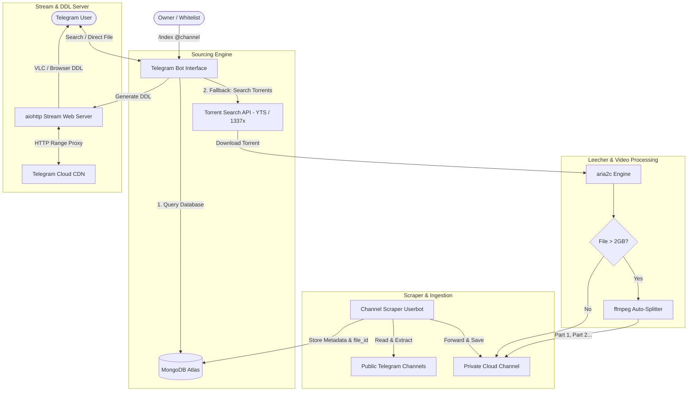

# StreamVault: Architecture & Implementation Plan

A private, ad-free Telegram media system combining **Channel Scraping**, **MongoDB AutoFilter**, **Direct Stream Link Generation**, and **Torrent Leeching** with no 15-hour token expirations.

### 🟢 Status Summary
* **Phase 1 (Active & Operational):** Telegram Channel Scraping, 1-Click Auto-Save, MongoDB Atlas Multi-token Search, `aiohttp` HTTP Range DDL streaming server, Whitelist security.
* **Phase 2 (Roadmap):** Google Colab Torrent Leeching Notebook (for 0-hotspot-data downloads of >2GB/4K releases) and Cloudflare Tunnel integration.

---

## 1. System Architecture



---

## 2. Directory Structure

```text
d:\Direct_Link\
├── .env.example               # Template for credentials & settings
├── requirements.txt           # Python dependencies
├── main.py                    # Application entry point
├── config.py                  # Environment variable loader & settings
├── bot/
│   ├── __init__.py
│   ├── client.py              # Bot and Userbot initialization
│   ├── handlers/
│   │   ├── start.py           # /start, /help, whitelist security checks
│   │   ├── search.py          # /search, text search, inline buttons
│   │   ├── indexer.py         # /index @channel, bulk scraping logic
│   │   └── leech.py           # Torrent download, progress bar, upload
│   └── utils/
│       ├── database.py        # MongoDB connection & CRUD queries
│       ├── torrent.py         # YTS & 1337x search fetchers
│       ├── splitter.py        # ffmpeg video splitter (>2GB handler)
│       └── streamer.py        # aiohttp range-request streaming server
├── scripts/
│   └── check_dependencies.ps1 # Auto-checker for aria2c, ffmpeg, python
└── docs/
    ├── setup-guide.md         # Credentials & MongoDB guide
    └── architecture-plan.md   # This architecture spec
```

---

## 3. Component Details

### A. Whitelist Security
- Checks `user.id in ALLOWED_USERS`.
- Unauthorized users receive an access-denied prompt, blocking token farming and unauthorized bandwidth usage.

### B. Channel Scraper & Storage Vault
- Uses an MTProto client (`Hydrogram` / `Pyrogram`) with your `API_ID` & `API_HASH`.
- Scrapes message history from public channels.
- Extracts video files, stores the `file_id`, file name, size, and message link into MongoDB.
- Forwarded into your private `LOG_CHANNEL_ID` so the file is under your permanent ownership.

### C. Search & Dual Delivery
1. User types `/search Interstellar` (or simply `Interstellar`).
2. Search query matches against MongoDB (`regex` on clean file titles).
3. Bot presents inline buttons showing matching resolutions and sizes.
4. If chosen:
   - Delivers the video file directly inside the chat.
   - Inserts the **Direct Download Link (DDL)** into the message caption (`https://<host>:<port>/stream/<file_id>`).

### D. Torrent Leech Fallback & Auto-Splitting
1. If not found in MongoDB, bot provides a `[ ⚡ Search Torrents ]` button.
2. Queries torrent APIs for top-seeded files across all qualities (480p up to 4K).
3. Clicking a torrent triggers `aria2c` to download directly to a temporary directory with live progress edits.
4. **File Size Check:**
   - If `<= 1.99 GB`: Uploads directly to Telegram.
   - If `> 1.99 GB`: Runs `ffmpeg -i file.mkv -c copy -map 0 -segment_time ...` to split into clean 1.9GB chunks without quality loss or re-encoding, then uploads all parts.
5. Deletes local temporary files immediately after upload to free disk space.
